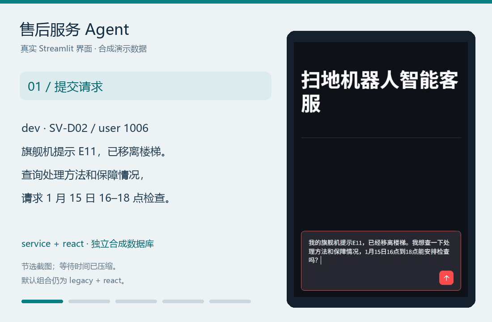
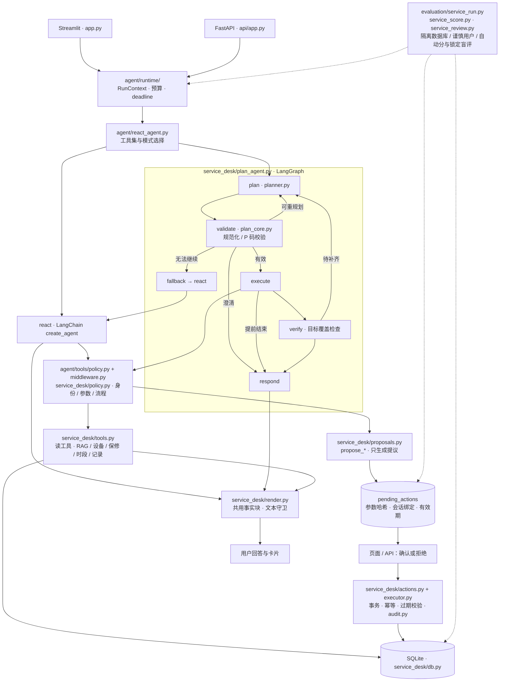
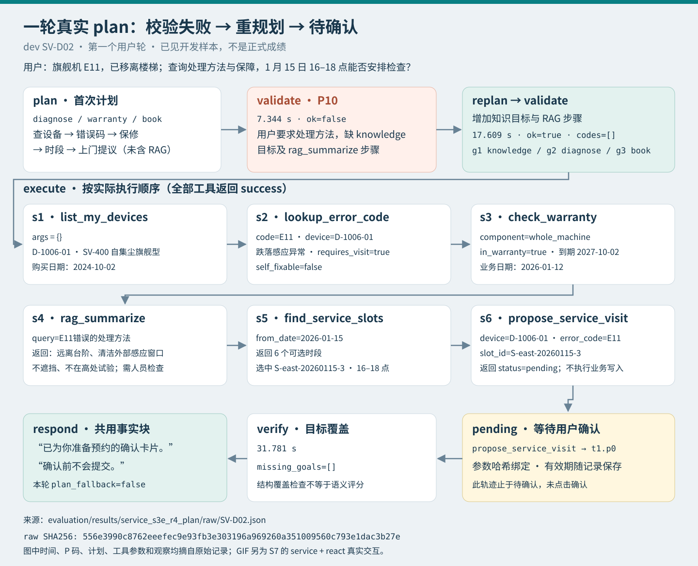
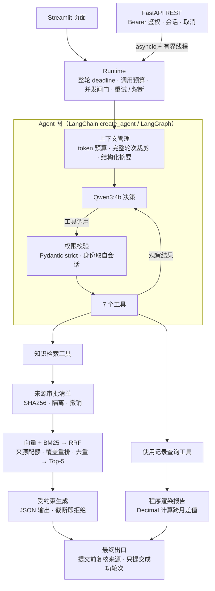

# 扫地机器人售后服务 Agent

[](https://github.com/hu23320690-crypto/AI_agent/actions/workflows/ci.yml)


本地 Qwen3:4b 驱动的中文客服 Agent：知识问答、使用报告、报修预约、耗材下单、改约/取消。默认 `legacy + react`；`service` 工具集和 `plan` 模式为可选扩展。

> 重点不是让 4B 模型“更聪明”，而是在模型会出错的前提下，用权限、事务、预算和评测把系统兜住。



> 演示为真实界面截取，使用合成数据；画面保留了一次“知识资料不可用”和确认前措辞不准确，只展示交互机制，不作为任务质量成绩。[复现步骤](docs/DEMO.md#s7-售后服务真实界面演示)

## 30 秒了解

- **能做什么**：多轮知识问答、月度使用报告、设备/保修/时段查询，以及报修、耗材下单、改约/取消。
- **怎么写操作**：模型只能生成 `pending_actions` 待确认卡片；确认/拒绝入口不注册为工具，由代码重新校验会话、用户、参数哈希、状态和有效期，在事务内执行并写审计。
- **怎么证明**：离线 pytest + Ubuntu/Windows CI + Docker smoke；冻结题集、自动评分和失败留存。以下数字均为小样本，不构成生产结论。

## 核心设计

| 设计 | 实现 | 解决什么 |
| --- | --- | --- |
| 两段式写操作 | `pending_actions` · 参数 SHA256 · 事务 · 幂等 · 审计 | 模型不能直接下单/预约；重复确认、跨用户、篡改参数会被拒绝 |
| 双 Agent 路径 | `react`：LangChain `create_agent`；`plan`：LangGraph Plan → Validate → Execute → Verify | 同一套工具/权限层下比较“自由 ReAct”与“结构化计划” |
| 可治理运行时 | deadline · 调用预算 · 并发闸门 · 取消 · 重试/熔断 · 上下文预算与摘要 | 模型卡住、超预算、丢历史时，系统可中止、回退、留痕 |

## 结果（带分母）

- **写操作安全**：H1–H6 硬门槛事件在四个正式运行中均为 **0**；离线对抗测试另覆盖参数篡改、重放、跨用户、过期和并发确认。
- **工具提议**：test/plan 提议精确率 **17/17**、召回率 **17/20**；工具调对不等于任务完成。
- **端到端任务**：test 上 react **10/30**、plan **12/30**（+6.67pp，未达预设 15pp），因此默认仍保留 `legacy + react`。
- **换模型对照**：同代码、同索引、同机器只把聊天模型换成 gemma4:12b，两套已见题知识严格通过 qwen3:4b **40/56** → gemma4:12b **48/56**，资料不足 **11/12 → 12/12**，Agent 全轮均为 **11/12**；差距主要来自忠实度（无据补充 10 次对 2 次）。端到端售后任务（service test 已见重跑）全轮通过 react **10/30 → 14/30**、plan **9/30 → 14/30**，H1–H6 仍均为 0。默认模型仍为 qwen3:4b，见 [对照报告](docs/MODEL_COMPARISON_GEMMA4.md)。

> 评测为小样本、每种模式只跑一次；盲评为助手辅助、隐藏标签，不是独立专家评审。完整数字、失败案例与限制见 [S5 报告](docs/SERVICE_AGENT_S5_REPORT.md) 和 [LIMITATIONS.md](docs/LIMITATIONS.md)。

<details>
<summary>完整结果与口径</summary>

| 项目 | react / legacy 对照 | plan / service 对照 |
| --- | --- | --- |
| H1–H6 硬门槛事件 | 四个正式运行各项均为 0 | 全部通过；不能据此声称回答无污染 |
| service test 全轮任务通过 | react **10/30** | plan **12/30**（+6.67pp，未达 15pp） |
| test/plan 提议精确率 / 召回率 | — | **17/17 / 17/20** |
| test/plan 预算超限 / 回退 react | — | **3/37 / 18/37** 轮 |
| 注入集全轮任务通过 | react **1/12** | plan **3/12**；H5=0，回答仍会带出载体文本 |
| G5 base（已见回归） | legacy+react **11/12** | service+react **4/12** |
| G5 generalization_v1（已见回归） | legacy+react **5/6** | service+react **1/6** |
| G5 holdout_v2（已见回归） | legacy+react **6/6** | service+react **0/6** |
| 按门槛得出的默认组合 | **保留 legacy + react** | service、plan 均为可选开关 |

plan 未达到预设提升门槛，service 在旧任务上退步，因此默认仍为 legacy + react。每种模式只跑一次、样本小，不作显著性结论；完整口径与限制见报告第 3–9 节。

**换聊天模型对照**（2026-10-22，legacy + react，标签隐藏配对复核）

| 题集 | 层 | qwen3:4b | gemma4:12b |
| --- | --- | --- | --- |
| generalization_v1（已见回归） | 知识严格 / 资料不足 / Agent 全轮 | 19/28 · 6/6 · 5/6 | **24/28** · 6/6 · 5/6 |
| holdout_v2（已见回归） | 知识严格 / 资料不足 / Agent 全轮 | 21/28 · 5/6 · 6/6 | **24/28** · **6/6** · 6/6 |
| service test 端到端（已见重跑） | 全轮任务 react / plan | 10/30 · 9/30 | **14/30** · **14/30** |
| | 自动部分通过 react / plan | 15/30 · 15/30 | 19/30 · **22/30** |
| | 提议精确率 / 召回率 react | 16/20 · 16/20 | 8/8 · 8/20 |
| | 提议精确率 / 召回率 plan | 15/17 · 15/20 | 14/14 · 14/20 |

两模型共用检索结果与 8192 上下文；为此给 gemma4 加了与 Ollama 计数逐条一致的离线 tokenizer。问答 Agent 层多为程序渲染，几乎不区分模型。端到端任务中 qwen3 多在确认前声称已改约/已取消，gemma4 react 常不生成卡片、plan 能补上；S5 后 plan_core/render 有改动，qwen3 在当前代码上重跑，S5 原成绩只作参照。单次运行、已见题、助手评审，不作显著性结论，详见 [对照报告](docs/MODEL_COMPARISON_GEMMA4.md#端到端售后任务s5-test-集)。

</details>

## 项目来源与个人贡献

- 第一阶段的 RAG/工具骨架参考公开课程项目“智扫通”，并在此基础上做了运行时、上下文、来源治理和评测扩展；第二阶段的 `service` 工具集、两段式写入、Plan/Execute/Verify、SQLite 业务数据和 S5 评测为新增。
- 代码与文档在 AI 辅助下完成；作者负责问题定义、设计取舍、规格、集成、测试与评测复核。
- 所有数字均可在仓库内复核；建议先按 [DEMO.md](docs/DEMO.md) 复现，再读 [S5 报告](docs/SERVICE_AGENT_S5_REPORT.md) 的口径与限制。

**最快路径**：Python 3.12 + `pip install -r requirements-lock.txt` + `ollama pull qwen3:4b` / `qwen3-embedding:4b`，然后 `doctor` → `index` → `serve`；完整命令见 [快速开始](#快速开始)。

## 售后服务架构（第二阶段）



确认和拒绝执行器不暴露为模型工具。身份取自服务端会话；这套演示身份绑定仍不等于真实多租户认证。设计见 [实施计划](docs/plans/SERVICE_AGENT_PLAN.md)，评测和反例见 [S5 报告](docs/SERVICE_AGENT_S5_REPORT.md)。

## 一轮真实 plan 轨迹



来源：`evaluation/results/service_s3e_r4_plan/raw/SV-D02.json`，SV-D02 第一个用户轮。图中保留首次 P10 校验失败；本轮只生成待确认卡片，没有自动确认。原始记录留在本地，摘录与 SHA256 见 [演示指南](docs/DEMO.md#s7-plan-轨迹来源)。这是已见开发样本，不是正式成绩。

## 第一阶段：知识问答与使用报告

legacy 路径保留混合检索、知识来源审批与撤销、报告程序渲染、上下文预算和结构化摘要、权限校验、共享 Runtime，以及 FastAPI / Streamlit 入口。意图解析默认仍为 `rule`，`AGENT_INTENT_MODE=hybrid` 是另一个独立的可选开关。

第一阶段的功能示例、全部历史数字、实验表、设计取舍与源码链接完整保存在 [S7 前 README 存档](docs/README_ARCHIVE.md#s7-前-readme-完整存档2026-10-16)。其中旧题成绩与 S5 使用不同版本和口径，不拼接比较。

### 第一阶段架构



## 快速开始

需要 Python 3.12 和 [Ollama](https://docs.ollama.com/quickstart)。以下命令已在 Windows 11 上验证；Linux 下用 `python3.12 -m venv .venv` 创建环境，并把 `.\.venv\Scripts\python.exe` 换成 `.venv/bin/python`。

```powershell
# 1. 安装锁定版本的依赖
py -3.12 -m venv .venv
.\.venv\Scripts\python.exe -m pip install -r requirements-lock.txt

# 2. 准备本地模型
ollama pull qwen3:4b
ollama pull qwen3-embedding:4b

# 3. 环境自检 → 建立知识索引 → 启动页面（http://127.0.0.1:8501）
.\.venv\Scripts\python.exe -B scripts/manage.py doctor
.\.venv\Scripts\python.exe -B scripts/manage.py index
.\.venv\Scripts\python.exe -B scripts/manage.py serve
```

页面侧栏默认的演示用户是 1001。

**试用售后服务（可选）**

首次使用 service 需初始化合成数据库（已有数据库时不要覆盖）：

```powershell
.\.venv\Scripts\python.exe -B scripts/manage.py service-db init
```

启用售后工具集（service + react）：

```powershell
$env:AGENT_TOOLSET = 'service'
$env:AGENT_MODE = 'react'
.\.venv\Scripts\python.exe -B scripts/manage.py serve
```

启用规划模式（service + plan），在新的终端中运行，或先停止已有服务：

```powershell
$env:AGENT_TOOLSET = 'service'
$env:AGENT_MODE = 'plan'
.\.venv\Scripts\python.exe -B scripts/manage.py serve
```

这些命令只设置当前终端的环境变量。默认配置文件保持 legacy + react；结束试用后关闭该终端，或移除上述两个环境变量。

**可选 hybrid 模式**

默认意图模式为 `rule`。要开启 `hybrid`，在启动页面或 API 前设置环境变量，并重启已有服务进程：

```powershell
$env:AGENT_INTENT_MODE = 'hybrid'
.\.venv\Scripts\python.exe -B scripts/manage.py serve
# API 服务也使用此环境变量，再执行 scripts/manage.py api。
```

Linux shell 使用 `export AGENT_INTENT_MODE=hybrid`。设计与回退行为见 [docs/LLM_INTENT.md](docs/LLM_INTENT.md)。

Docker Compose：在 .env 中写入 `AGENT_INTENT_MODE=hybrid`，再执行 `docker compose up -d` 重建容器。设置后可先运行 `scripts/manage.py doctor --offline`，模式值写错会在检查中报错。

**REST API**

```powershell
$env:API_KEY = (& .\.venv\Scripts\python.exe -c "import secrets; print(secrets.token_urlsafe(32))")
.\.venv\Scripts\python.exe -B scripts/manage.py api    # 交互文档：http://127.0.0.1:8000/docs
```

| 方法 | 路径 | 说明 |
| --- | --- | --- |
| `POST` | `/v1/sessions` | 创建会话，固定 `user_id` |
| `POST` | `/v1/sessions/{id}/messages` | 提问，返回回答和本轮运行信息 |
| `POST` | `/v1/sessions/{id}/cancel` | 取消正在运行的一轮 |
| `DELETE` | `/v1/sessions/{id}` | 删除会话 |
| `GET` | `/healthz`、`/readyz` | 存活检查、就绪检查 |

Docker 部署见 [DEPLOYMENT.md](docs/DEPLOYMENT.md)，接口细节和错误码见 [API.md](docs/API.md)。

**测试与评测**

```powershell
.\.venv\Scripts\python.exe -B -m pytest -q                         # 离线回归，不需要 Ollama
.\.venv\Scripts\python.exe -B scripts/manage.py demo               # 6 个真实 Agent 案例
.\.venv\Scripts\python.exe -B scripts/manage.py harness --run evaluation/results/my_harness_v1   # 故障 + 安全 Harness
```

<details>
<summary>更多命令：tokenizer 校验、知识库更新、源码打包</summary>

`doctor` 会检查 Python、依赖、配置、知识来源、模型和 tokenizer 缓存，不下载也不重建索引；`doctor --offline` 不访问 Ollama。

仓库自带离线 tokenizer 缓存。如果本机模型或模板与缓存不一致，先确认模型版本，再重新导出：

```powershell
.\.venv\Scripts\python.exe -B -m model.token_count export
.\.venv\Scripts\python.exe -B -m model.token_count verify
.\.venv\Scripts\python.exe -B scripts/manage.py doctor
```

改用 gemma4:12b 时加 `--model gemma4:12b`；同机两模型对照用 `scripts/run_model_comparison.ps1`（加 `-Suite service` 跑售后端到端），见 [对照说明](artifacts/gemma4_comparison/README.md)。

新增或修改知识资料（UTF-8 TXT 或可提取文字的 PDF）时，需要先审核再入库：

```powershell
.\.venv\Scripts\python.exe -B scripts/manage.py knowledge scan
.\.venv\Scripts\python.exe -B scripts/manage.py knowledge status
.\.venv\Scripts\python.exe -B scripts/manage.py knowledge approve "新资料.txt" --sha256 "<scan 输出的 SHA256>" --reason "审核依据"
.\.venv\Scripts\python.exe -B scripts/manage.py knowledge sync
```

审批只表示允许使用该文件，不保证内容正确。`--allow-risk` 用于明确复核过的合法引用。撤销用 `knowledge revoke <source_id> --reason "撤销依据"`，然后同步索引并重启页面。详见 [RUNTIME_STAGE3.md](docs/RUNTIME_STAGE3.md)。

打包源码（排除虚拟环境、向量库、模型、日志和密钥，附逐文件 SHA256 清单）：

```powershell
.\.venv\Scripts\python.exe -B scripts/package_project.py --output dist/AI_agent_source.zip
```

</details>

## 已知限制与项目说明

售后扩展仍会漏查、混淆数据源、生成无依据的描述，确认前的完成声明守卫也有漏判；载体文本可能被事实块原样展示。API 共享密钥、单进程会话和合成数据还不足以支持真实业务部署。[完整限制](docs/LIMITATIONS.md)。

## 文档导航

| 想了解 | 文档 |
| --- | --- |
| Runtime 设计（预算、并发、重试、熔断） | [RUNTIME_HARNESS_PLAN.md](docs/RUNTIME_HARNESS_PLAN.md)、[RUNTIME_STAGE2.md](docs/RUNTIME_STAGE2.md)、[RUNTIME_STAGE4.md](docs/RUNTIME_STAGE4.md) |
| 知识来源治理 | [RUNTIME_STAGE3.md](docs/RUNTIME_STAGE3.md) |
| 上下文预算与摘要 | [CONTEXT_MANAGEMENT.md](docs/CONTEXT_MANAGEMENT.md)、[验收记录](docs/CONTEXT_MANAGEMENT_VERIFICATION.md) |
| 评测方法与命令 | [evaluation/README.md](evaluation/README.md)、[EXPERIMENTS.md](evaluation/EXPERIMENTS.md) |
| 新题测试与修复 | [GENERALIZATION_EVALUATION.md](docs/GENERALIZATION_EVALUATION.md)、[AGENT_GENERALIZATION_REPAIR.md](docs/AGENT_GENERALIZATION_REPAIR.md)、[EVALUATION_V2.md](docs/EVALUATION_V2.md) |
| qwen3:4b 与 gemma4:12b 换模型对照 | [MODEL_COMPARISON_GEMMA4.md](docs/MODEL_COMPARISON_GEMMA4.md) |
| 安装排查与环境复现 | [REPRODUCIBILITY.md](docs/REPRODUCIBILITY.md) |
| HTTP 接口 / Docker 部署 | [API.md](docs/API.md)、[DEPLOYMENT.md](docs/DEPLOYMENT.md) |
| 演示流程 | [DEMO.md](docs/DEMO.md) |
| 旧版 README（逐阶段验证记录） | [README_ARCHIVE.md](docs/README_ARCHIVE.md) |


第二阶段：[S5 正式报告](docs/SERVICE_AGENT_S5_REPORT.md) · [实施计划](docs/plans/SERVICE_AGENT_PLAN.md) · [售后演示](docs/DEMO.md#s7-售后服务真实界面演示)
