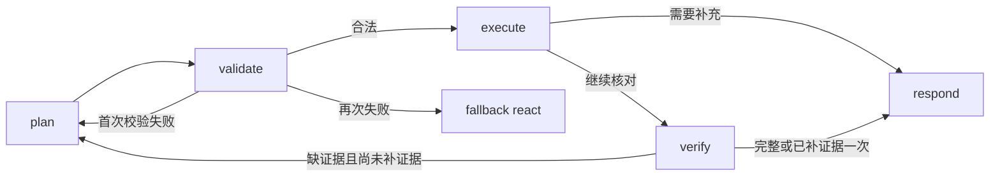

# S3-C 实现与验证记录（2026-10-15）

本阶段只实现集成，不做 dev 调优、正式评测或合并。默认仍为 legacy + react。

## 实现

`agent/mode.py` 读取 `config/agent_mode.yml` 与 `AGENT_MODE`；plan 只允许 service。
`ReactAgent` 保留原入口、锁、取消、来源重校验和成功提交边界；service 两种模式只提交用户原话与最终回答。
legacy 的工具清单、提示与回答分支不变。

LangGraph 节点与边：



planner 使用 `plan_core.plan_json_schema()`，按现有上下文预算准入，先裁剪最近两轮历史、再删卡片摘要，保留本轮原话。
Ollama 使用原始 schema、关闭思考、沿用已有输出上限；每次请求计入同一 Runtime 模型预算。
截断、非法 JSON、重复键与非有限常量均记 P1。校验重试和 verify 补证据各最多一次，planner 总计最多三次。
verify 按目标类型核对实际工具证据，补证据必须保留缺失目标的 id/type/text，不得给已处理目标增加工作；
已完成步骤以只读虚拟前缀参与校验，不再计入剩余调用预算。相同成功读取可直接复用。
回退复用同一 RunContext，若已执行部分计划，将真实工具观察交给 react 继续，最终历史不保存这些中间消息。

实际工具路径：`PlanTurn._call` → `monitored_tool_call`（react 的 `monitor_tool` 也调用它）→
`_monitored_tool` → `authorize_tool`/service policy → `runtime_call('tool', ...)` →
同一 `StructuredTool.func` → `execute_service_tool` → 读取或 pending 提议。
参数长度、权限、Runtime、错误处理、turn_trace 均共用；月度记录仍由原服务工具写入 context。
写步骤依次 resolve_args、evaluate_condition、precheck；跳过步骤不派发工具。
设备/时段歧义分别转 which_device/which_slot，时段未命中记录 slot_unavailable。
快照新增 planner_calls、replans、plan_fallback、skipped_steps。

## 审核模块接入差异

- 两模块增加所要求的 DeepSeek 来源说明；两测试文件改项目导入，原有断言保留。
- plan_core 的函数、常量与校验逻辑未改。新增参数名、必填项、类型、枚举与公开工具 schema 的一致性测试。
- render 必要修改一：RAG answer 原样保留全角字符、换行与制表符，落实“answer 原样”。
- render 必要修改二：compose 最后放待确认卡片说明，兼容 react 在提议后继续读取；render_facts 的调用顺序仍保持。
- render 必要修改三：同一读取失败后由 verify 恢复成功时，去重保留成功证据，避免第一次失败遮住恢复结果；仍只渲染一次。
- 上述三点均新增测试；暂存的 deepseek 目录已移除，不提交原暂存目录。

## 验证

干净基线 main：`9bd87e5`。首次运行因 Windows 沙箱临时目录原子重命名权限出现环境失败；
改用工作区 TEMP/TMP，在独立的同版本 checkout 重跑：**1802 passed、3 skipped、291 subtests passed**。
基线 doctor：**155 checked、0 failures**。

新增/移入测试：**303 passed**。覆盖合法 pending 卡片、校验重试及回退、条件/预检跳过、设备/时段歧义、
时段无名额、verify 缺失/读取失败恢复、只补缺失目标、卡片沿用、预算、仅公开历史、react 事实与守卫、
假模型运行器 CLI/子进程/manifest。legacy 意图兼容回归也已复查。

三种 doctor（默认、service + react、service + plan）：均 **156 checked、0 failures**。

首次完整回归为 **2082 passed、23 failed、3 skipped、291 subtests passed**；23 项均来自两份旧测试与新规格的冲突。
作者在本次会话中明确批准两文件迁移补丁，现已应用。最终完整回归：
**2105 passed、0 failed、3 skipped、291 subtests passed**，使用仓库外工作区临时目录复跑。

旧测试修改范围（经作者批准）：

- `test_service_agent.py` 的 graph 夹具增加 TurnTrace，工具观察从真实轨迹读取，不再要求 ToolMessage 持久保存。
  原有权限、身份、参数、预算、会话和数据库断言保留；更新受影响的回答精确断言，包含事实块、资料说明和失败事实。
  将四处旧的“无事实记号的虚构文本”夹具改成带 `99999天` 的无依据文本，继续检验文本守卫拒绝虚构事实。
- `test_service_eval_runner.py` 只有“S3 尚未实现，plan 必须拒绝”测试改为检查 plan 进入正常数据集门禁。
  新增的独立 CLI/子进程测试验证实际执行和 manifest mode；没有放宽生产拦截规则。

两文件迁移提案独立副本曾 **60 passed**。首轮 Linux CI 还暴露新增运行器测试将合成输入放在仓库外的夹具错误；
已改为仅把自拟合成输入放进仓库临时 work 目录，符合运行器原有的相对路径身份合同，测试结束自动清理。

## 唯一真实冒烟

本机 `qwen3:4b`，自拟请求“我的设备在保吗”，用户 1002，plan 模式，独立种子库。
原始含 `$defs`、`$ref` 的 schema 被 Ollama 接受，无须展开；输出解析及 P1–P8 校验通过。
一轮 **1 次 planner / 1 次模型 / 2 次工具**，**0 重规划 / 0 回退**，Runtime 约 **10.203 秒**。
输入预算估计 **2968 / 3840**，使用已锁定本地 Qwen tokenizer。
原始响应与 schema、实际轨迹见 `S3C_OLLAMA_SMOKE.json`。

planner 原始文本：

```json
{"goals": [{"id": "g1", "type": "warranty", "text": "查询设备保修状态"}], "steps": [{"id": "s1", "tool": "list_my_devices", "args": {}, "depends_on": [], "covers": ["g1"]}, {"id": "s2", "tool": "check_warranty", "args": {"device_id": {"from_step": "s1", "pick": "only_device"}}, "depends_on": ["s1"], "covers": ["g1"]}]}
```

## 设计取舍与范围

沿用 S3_DESIGN 的来源格式和 P1–P8，覆盖主计划第 8 节较早的 user_text/ref 示例。
verify 采用目标类型对应的证据工具，防止设备清单错误地满足保修等目标。
plan 补证据校验通过虚拟前缀兼容审核核心，不给 plan_core 新增特殊校验入口。
计划验证和运行控制保持不同语义：计划不合法可以重规划，预算/取消/超时仍终止且不提交。
原始 schema 已获实际 Ollama 接受，未添加无依据的 schema 展开分支。
未改变冻结文件、默认开关、依赖或预算；未使用 formal，未直接查看或检索隔离题面及两份 GOLD_REVIEW，
也未在新增代码/测试中引用；仅按要求执行既有离线回归，未做 dev 调优。
旧测试迁移已经作者明确批准；未扩展此例外到其他旧测试，未删除原有安全断言。
